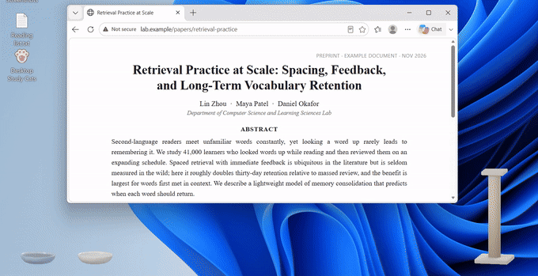

# Desktop Study Cats (桌面学习猫)

**Two realistic cats live on your Windows desktop and keep you company while you study: instant word lookup, review, goals and study time, with a cat that cheers you on.**

Desktop Study Cats starts with one thing: select a word in any app (a novel, a PDF, a web page, a subtitle)
and tap **Ctrl+Shift**. A small card pops up with the translation and pronunciation, and you hear
the word read aloud. Then you go back to reading.

Around that card, the app grows features you can switch on or off: spaced-repetition review of the
words you looked up, long-term goals and dated to-dos with stopwatches, a library check-in, and a
journal that collects every day into one page you can reflect on. Each feature is one module, so
adding the next one doesn't touch the rest (see [Adding a feature](#adding-a-feature)).



▶ **[Watch the full demo with narration](docs/demo.mp4)** (2:04): English and Spanish books,
screenshot OCR, settings, and spaced-repetition review.

## What it does

### Word lookup (always on)

- **Works in every app.** Select text anywhere, then tap Ctrl+Shift. Text you can't select
  (images, scanned PDFs, video frames) works too: snip it with Win+Shift+S and the app reads
  it with Windows' built-in OCR.
- **Hear it right away.** Natural neural voices (Microsoft Edge TTS) with regional accents: US,
  UK or Australian English; Spain or Mexico Spanish; Brazil or Portugal Portuguese; and more.
- **More than a translation.** You get IPA for English, romanization for languages like Chinese
  (pinyin), Japanese (romaji) and Russian, and dictionary senses grouped by part of speech.
- **12 languages, either direction.** Choose the language you're learning and the language to
  translate into. Select text in *your own* language and you get it in the language you're
  learning, spoken aloud.
- **Two cats on your desktop.** Realistic cats with real fur live along the bottom of the screen. The first
  carries the card as its speech bubble and shows its moods (thinking, talking, worried, celebrating,
  sleepy); click it to hear the word again, drag either one to move it, and stroke one (move the mouse back and
  forth over it) to pet it: it leans into your hand with its eyes closed and hearts over its head. The second keeps it company. They
  sit about, blink, groom, yawn, nap and wander; while you work they stay calm, and when you step away they
  touch noses, groom each other, chase, and nap cuddled up. They stretch after a nap and roll over when they're
  happy. Right-click → **Toss in the yarn ball / bell ball** and a toy drops onto the desktop: the cats stalk it,
  pounce, swat it about, bat the ball back and forth between them or race for the yarn. Drag a toy to tease them
  (let go to throw it). They have a food bowl, a water bowl, a scratching post and a bed on the desktop floor
  (drag them where you like, or right-click → **Put the bowls, post and bed away**): they drink when thirsty, scratch the post, nap in the bed (cuddled up together
  too), swish their tails, arch when something whizzes past and rub cheeks with each other. They get hungry over
  a few hours; right-click → **Feed the cats** fills the bowl and they come and eat from either side. With an
  empty bowl, a hungry cat sits by it and meows at you. Right-click → **Cats…** names each cat and picks its coat
  (8) and body (adult, kitten, slim, longhair), or turns the second cat off. Turn them off in Settings →
  Features to get the plain card back.
- **A face on the card** (when the desktop cats are off). A little bubble that blinks, thinks while the study buddy is
  working, opens its mouth when it has a question, looks worried when you haven't studied, dozes when
  paused, and celebrates when you finish something.
- **A card that stays put.** The card sits quietly in a corner. Click it to hear the word again,
  drag it anywhere, and right-click it for everything else.

### Features (each can be turned off in Settings)

- **Study buddy (Claude).** A slightly fussy friend to chat with while you study. It runs Claude
  Code in the background with the Claude login already on your computer (no API key) and reads none
  of your files. Mornings bring deadline countdowns from your goals, evenings a nudge if you barely
  studied, and once a day it shares something new, picked from what you've been curious about.
  Quiet 23:00-08:00. Your messages and the titles of the study windows you have open go to Claude.
  Off by default.
- **The cat's bond.** Studying brings you closer to your cat. Word review (a forgotten word still counts),
  finished tasks and goals, library visits and study time (capped per day) earn ♥. Levels unlock a nickname the cat calls you and things it wears (sprout,
  bow, grad cap, star clip, crown), and the desktop pet grows a little. The bond never goes down and there's
  no streak to lose, so rest days are fine. Points tied to practice rather than time, and no loss-framed
  streaks, follow the research on rewards and motivation (self-determination theory).
- **Word list and review.** Every lookup goes into a local SQLite word list. Review uses
  flash cards with growing intervals (1 → 2 → 4 → 7 → 15 → 30 → 60 days). Search, delete and
  export to CSV (opens in Excel, and imports into Anki).
- **Goals & to-dos.** Long-term goals (deadline from a calendar, countdown, tasks done and time
  spent) and tasks you can plan for any day, attach to a goal and time with a stopwatch.
  Finishing a task or a goal pops up a small celebration with how many days it took since you
  wrote it down.
- **Study time, detected on its own.** The app notices which program or site is in front and whether
  you're at the keyboard, and counts the time you actually study: VS Code, PDFs, Brightspace, Google
  Docs and lectures count; YouTube, social apps and time away don't. A list of everything you used
  lets you re-sort any program or site with one click, and past days are re-counted. Shows today,
  this week and a 7-day chart, and adds a section to the journal. Only kept on your computer. Off by
  default.
- **Claude usage on the card.** A small badge shows how much of your Claude plan's 5-hour limit
  is used (grey, yellow from 50%, red from 80%); click it for when it resets, or see every limit in
  the menu. Read from Claude Code's `/usage` every 5 minutes, which uses no quota. Off by default.
- **Library check-in.** One menu item checks you in or out, whichever applies. Checking in opens
  your goals and to-dos. Checking out tells you how long you stayed and how many tasks you
  finished. The library log has today / this week / your streak, a calendar heatmap, and the new
  words and tasks done each day. Off by default.
- **A journal to look back on.** One page per day with the tasks you finished and how long each
  took, the new words you looked up (click to hear them), your library time, and a reflection you
  write yourself. New features plug in as extra sections.
- **Stays out of your way.** A plain Ctrl+C never triggers it, your clipboard is restored after a
  lookup, and you can pause it from the menu.

## Quick start

Requirements: **Windows 10/11** and **Python 3.10+** ([python.org](https://www.python.org/downloads/)).
Tested with Python 3.12.

```bat
git clone https://github.com/jia-jing-zhang-dev/desktop-study-cats.git
cd desktop-study-cats
setup.bat
```

`setup.bat` creates a virtual environment, installs the three dependencies and starts the app.
The card appears in the bottom-right corner of your screen. After that, start it with `run.bat`,
or turn on **Start with Windows** in Settings.

### Standalone app (no Python needed)

To give the app to someone who doesn't have Python, build a self-contained folder:

```bat
.venv\Scripts\python -m pip install pyinstaller
.venv\Scripts\python packaging\build.py
```

This creates `dist\DesktopStudyCats-windows.zip` (about 21 MB) with `DesktopStudyCats.exe` and a bilingual
how-to. The packaged app keeps its settings and word list in `%APPDATA%\Word Popper` (an old name, kept so data stays put). It isn't
code-signed, so the first time it runs Windows SmartScreen asks for confirmation
(**More info → Run anyway**).

## How to use it

| You want to… | Do this |
| --- | --- |
| Look up a word, phrase or sentence | Select it, then tap **Ctrl+Shift** (press both, release, nothing else) |
| Look up text you can't select | **Win+Shift+S** and snip just the word |
| Hear it again | Left-click the card |
| Move the card | Drag it |
| Review your words | Right-click → **Review**. Space shows the answer, **1** = forgot, **2** = knew it |
| Browse, search, export | Right-click → **My words** |
| Change languages, voice, speed, trigger | Right-click → **Settings…** |
| Stop it for a while | Right-click → **Pause** |
| Check in / out at the library | Right-click → **Library check-in** (turn on *Library check-in* in Settings first) |
| Plan what to do there | Checking in opens **Goals & to-dos**, or right-click → **Goals & to-dos** |
| See your library time and streak | Right-click → **Library log…** |
| Look back on a day and write a reflection | Right-click → **Journal…** |
| Chat with the study buddy | Right-click → **Chat with Tiger…** (the first cat's name), or click the card when it says the cat has a message |

Sentences are translated and read aloud, but only words and short phrases (up to 4 words) go into
your word list.

## Languages

You can learn and translate between any of these:

| Language | Voices | Pronunciation guide |
| --- | --- | --- |
| English | US, UK, Australia | IPA |
| Chinese (Simplified / Traditional) | Mainland, Taiwan, Hong Kong | Pinyin |
| Japanese | Japan | Romaji |
| Korean | Korea | Romanization |
| French | France, Canada | — |
| German | Germany | — |
| Spanish | Spain, Mexico | — |
| Italian | Italy | — |
| Portuguese | Brazil, Portugal | — |
| Russian | Russia | Transliteration |
| Vietnamese | Vietnam | — |

The interface is available in English and Simplified Chinese. To add another language, add a
block to [`i18n.py`](i18n.py) and an entry to [`languages.py`](languages.py).

For screenshot OCR in a language other than English, Windows needs that language's OCR pack:
**Settings → Time & language → Language & region → Add a language**.

## Settings

| Setting | What it does |
| --- | --- |
| Interface language | English or 简体中文 |
| I'm learning | The language you read in. Spoken with the voice below |
| Translate into | Your own language |
| Voice | Regional accent for the language you're learning |
| Speech speed | Slow, relaxed, normal or fast |
| Look up a word by | *Ctrl+Shift tap* (default) or *Copying (Ctrl+C)* |
| Translate screenshots | Turn Win+Shift+S OCR on or off |
| Start with Windows | Adds or removes a shortcut in your Startup folder |
| Features | Turn word review, goals & to-dos, study time, library check-in and the journal on or off. A library session you forget to end stops after 8 hours |

Settings are saved in `settings.json` and your words in `vocab.db`, both next to the script.
Set the `WORD_POPPER_HOME` environment variable to keep them somewhere else.

## Privacy

The app has no account, no server and no telemetry. To do its job, it sends the text you
look up to these services:

- **Google Translate** (public web endpoint) for translation, dictionary senses and romanization
- **Youdao Dictionary** for English ↔ Chinese phonetics and definitions
- **Microsoft Edge text-to-speech** for the voices

Nothing else leaves your computer. OCR runs locally on Windows' own engine, and your word list is
a local file.

## Troubleshooting

- **Ctrl+Shift also switches my keyboard layout.** Windows uses Ctrl+Shift to switch keyboard
  layouts when you have more than one installed. Either turn that off (**Settings → Time &
  language → Typing → Advanced keyboard settings → Input language hot keys**) or set *Look up a
  word by* to *Copying (Ctrl+C)*.
- **No sound.** Edge voices need an internet connection. Offline, the app falls back to the
  built-in Windows voice.
- **"No text selected".** Some apps (games, some terminals) don't support copying. Use
  Win+Shift+S instead.
- **Nothing happens in an app running as administrator.** Windows blocks keystrokes sent from a
  normal app to an elevated one, so the app can't copy the selection there. Run the app as
  administrator too, or use a screenshot.

## Project layout

```
word_popper.py      the card, hotkey, clipboard watching and lookup flow
lookup.py           translation (Google), dictionary (Youdao), OCR (Windows.Media.Ocr)
speech.py           Edge TTS with an mp3 cache; SAPI fallback
vocab.py            SQLite word list, review window, word-list window
library.py          library check-in sessions, streaks, goals and to-dos, and their windows
journal.py          day-by-day journal built from each feature's sections, with written reflections
focus.py            study-time detection: foreground window + idle time, rules, the study-time window
buddy.py            study buddy: runs `claude -p`, the chat window, its tables
bond.py             the cat's bond: points, levels, accessories, the bond window
features/           one module per feature (review, todos, library, journal...); copy _template.py to add one
settings_window.py  settings UI and Start-with-Windows shortcut
languages.py        supported languages, voices, OCR tags
i18n.py             interface strings
```

## Adding a feature

Everything beyond word lookup is a feature in [`features/`](features): a small class that can add
right-click menu items, a window, a timer, and a section to each journal page. To add one, copy
[`features/_template.py`](features/_template.py), add its strings in both languages to
[`i18n.py`](i18n.py), and list it in [`features/__init__.py`](features/__init__.py). It then shows
up in the menu, in Settings → Features, and in the journal. [`CLAUDE.md`](CLAUDE.md) has the details.

## How the demo was made

The demo is recorded for real, with no mock-ups. [`demo/record.py`](demo/record.py) opens
[`demo/book.html`](demo/book.html) full-screen (public-domain excerpts from *Pride and Prejudice*
and *Don Quijote*), runs the app with a throw-away data folder, and drives the mouse and
keyboard while ffmpeg records the screen. [`demo/edit.py`](demo/edit.py) adds the captions and
key badges and a voice-over, and rebuilds the word audio from the app's own playback log. Where a
narration line needs more room, the picture holds still so the narrator never talks over a word. To re-record:

```bat
.venv\Scripts\python -m pip install -r demo\requirements.txt
.venv\Scripts\python demo\make_assets.py
.venv\Scripts\python demo\record.py
.venv\Scripts\python demo\edit.py
```

Snipping Tool must be in **Rectangle** mode. The script switches it for you.

## Credits

The desktop cats are renders of **"An Animated Cat"** by **Evil_Katz**, CC-BY-4.0, from
[Sketchfab](https://sketchfab.com/3d-models/an-animated-cat-aec25699660043a29595f9572149d1e8), re-posed,
re-coloured and given fur for this app. See [`assets/cats/CREDITS.md`](assets/cats/CREDITS.md) and
[`tools/cat_render/`](tools/cat_render/).

## License

[MIT](LICENSE)
