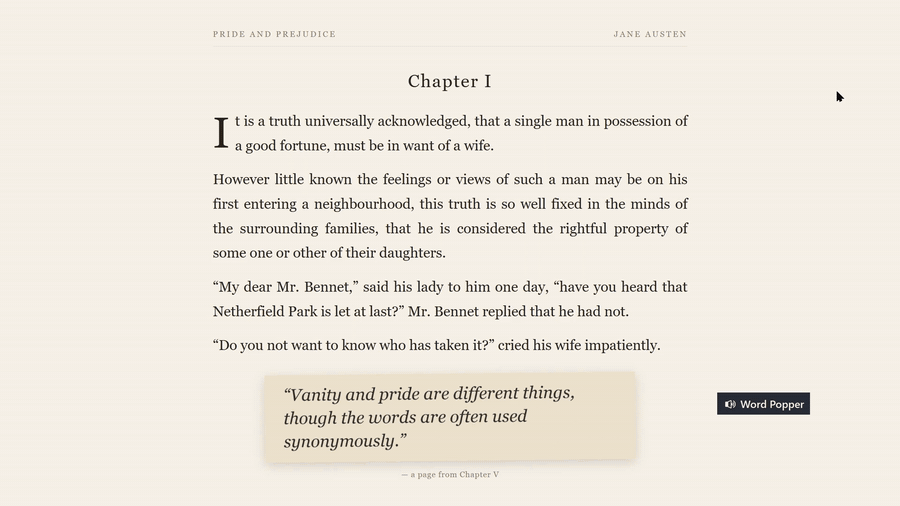

# Word Popper

**Learn vocabulary inside whatever you're already reading.**

Word Popper is a tiny Windows companion for reading in a foreign language. Select a word in any
app (a novel, a PDF, a web page, a subtitle) and tap **Ctrl+Shift**. A small card pops up with the
translation and pronunciation, and you hear the word read aloud. Then you go back to reading.
Every word you look up is saved, and you can review it later with spaced-repetition flash cards.

You don't need a dictionary app, a browser tab, or a flash-card deck to set up. You learn the
words that come up in the book you're actually reading, at the moment you need them.



▶ **[Watch the full demo with narration](docs/demo.mp4)** (2:04): English and Spanish books,
screenshot OCR, settings, and spaced-repetition review.

## Features

- **Works in every app.** Select text anywhere, then tap Ctrl+Shift. Text you can't select
  (images, scanned PDFs, video frames) works too: snip it with Win+Shift+S and Word Popper reads
  it with Windows' built-in OCR.
- **Hear it right away.** Natural neural voices (Microsoft Edge TTS) with regional accents: US,
  UK or Australian English; Spain or Mexico Spanish; Brazil or Portugal Portuguese; and more.
- **More than a translation.** You get IPA for English, romanization for languages like Chinese
  (pinyin), Japanese (romaji) and Russian, and dictionary senses grouped by part of speech.
- **A card that stays put.** The card sits quietly in a corner. Click it to hear the word again,
  drag it anywhere, and right-click it for everything else.
- **Built-in word list and review.** Every lookup goes into a local SQLite word list. Review uses
  flash cards with growing intervals (1 → 2 → 4 → 7 → 15 → 30 → 60 days). Search, delete and
  export to CSV (opens in Excel, and imports into Anki).
- **12 languages, either direction.** Choose the language you're learning and the language to
  translate into. Select text in *your own* language and you get it in the language you're
  learning, spoken aloud.
- **Optional library check-in with a to-do list.** One menu item checks you in or out, whichever
  applies. Checking in opens today's to-do list (unfinished tasks carry over), and checking out
  tells you how long you stayed and how many tasks you finished. The library log has today / this
  week / your streak, a calendar heatmap, and the new words and tasks done each day. Off by default.
- **Stays out of your way.** A plain Ctrl+C never triggers it, your clipboard is restored after a
  lookup, and you can pause it from the menu.

## Quick start

Requirements: **Windows 10/11** and **Python 3.10+** ([python.org](https://www.python.org/downloads/)).
Tested with Python 3.12.

```bat
git clone https://github.com/jia-jing-zhang-dev/Real-Time-Translate-MCP-.git
cd Real-Time-Translate-MCP-
setup.bat
```

`setup.bat` creates a virtual environment, installs the three dependencies and starts the app.
The card appears in the bottom-right corner of your screen. After that, start it with `run.bat`,
or turn on **Start with Windows** in Settings.

### Standalone app (no Python needed)

To give Word Popper to someone who doesn't have Python, build a self-contained folder:

```bat
.venv\Scripts\python -m pip install pyinstaller
.venv\Scripts\python packaging\build.py
```

This creates `dist\WordPopper-windows.zip` (about 21 MB) with `WordPopper.exe` and a bilingual
how-to. The packaged app keeps its settings and word list in `%APPDATA%\Word Popper`. It isn't
code-signed, so the first time it runs Windows SmartScreen asks for confirmation
(**More info → Run anyway**).

## How to use it

| You want to… | Do this |
| --- | --- |
| Look up a word, phrase or sentence | Select it, then tap **Ctrl+Shift** (press both, release, nothing else) |
| Look up text you can't select | **Win+Shift+S** and snip just the word |
| Hear it again | Left-click the card |
| Move the card | Drag it |
| Review your words | Right-click → **Review**. Space shows the answer, **1** = forgot, **2** = knew it |
| Browse, search, export | Right-click → **My words** |
| Change languages, voice, speed, trigger | Right-click → **Settings…** |
| Stop it for a while | Right-click → **Pause** |
| Check in / out at the library | Right-click → **Library check-in** (turn on *Library check-in* in Settings first) |
| Plan what to do there | Checking in opens **Today's to-dos**, or right-click → **Today's to-dos** |
| See your library time and streak | Right-click → **Library log…** |

Sentences are translated and read aloud, but only words and short phrases (up to 4 words) go into
your word list.

## Languages

You can learn and translate between any of these:

| Language | Voices | Pronunciation guide |
| --- | --- | --- |
| English | US, UK, Australia | IPA |
| Chinese (Simplified / Traditional) | Mainland, Taiwan, Hong Kong | Pinyin |
| Japanese | Japan | Romaji |
| Korean | Korea | Romanization |
| French | France, Canada | — |
| German | Germany | — |
| Spanish | Spain, Mexico | — |
| Italian | Italy | — |
| Portuguese | Brazil, Portugal | — |
| Russian | Russia | Transliteration |
| Vietnamese | Vietnam | — |

The interface is available in English and Simplified Chinese. To add another language, add a
block to [`i18n.py`](i18n.py) and an entry to [`languages.py`](languages.py).

For screenshot OCR in a language other than English, Windows needs that language's OCR pack:
**Settings → Time & language → Language & region → Add a language**.

## Settings

| Setting | What it does |
| --- | --- |
| Interface language | English or 简体中文 |
| I'm learning | The language you read in. Spoken with the voice below |
| Translate into | Your own language |
| Voice | Regional accent for the language you're learning |
| Speech speed | Slow, relaxed, normal or fast |
| Look up a word by | *Ctrl+Shift tap* (default) or *Copying (Ctrl+C)* |
| Translate screenshots | Turn Win+Shift+S OCR on or off |
| Start with Windows | Adds or removes a shortcut in your Startup folder |
| Library check-in | Shows check-in / check-out and the library log in the menu. A session you forget to end stops after 8 hours |

Settings are saved in `settings.json` and your words in `vocab.db`, both next to the script.
Set the `WORD_POPPER_HOME` environment variable to keep them somewhere else.

## Privacy

Word Popper has no account, no server and no telemetry. To do its job, it sends the text you
look up to these services:

- **Google Translate** (public web endpoint) for translation, dictionary senses and romanization
- **Youdao Dictionary** for English ↔ Chinese phonetics and definitions
- **Microsoft Edge text-to-speech** for the voices

Nothing else leaves your computer. OCR runs locally on Windows' own engine, and your word list is
a local file.

## Troubleshooting

- **Ctrl+Shift also switches my keyboard layout.** Windows uses Ctrl+Shift to switch keyboard
  layouts when you have more than one installed. Either turn that off (**Settings → Time &
  language → Typing → Advanced keyboard settings → Input language hot keys**) or set *Look up a
  word by* to *Copying (Ctrl+C)*.
- **No sound.** Edge voices need an internet connection. Offline, Word Popper falls back to the
  built-in Windows voice.
- **"No text selected".** Some apps (games, some terminals) don't support copying. Use
  Win+Shift+S instead.
- **Nothing happens in an app running as administrator.** Windows blocks keystrokes sent from a
  normal app to an elevated one, so Word Popper can't copy the selection there. Run Word Popper as
  administrator too, or use a screenshot.

## Project layout

```
word_popper.py      the card, hotkey, clipboard watching and lookup flow
lookup.py           translation (Google), dictionary (Youdao), OCR (Windows.Media.Ocr)
speech.py           Edge TTS with an mp3 cache; SAPI fallback
vocab.py            SQLite word list, review window, word-list window
library.py          library check-in sessions, streaks, to-do list, library-log and to-do windows
settings_window.py  settings UI and Start-with-Windows shortcut
languages.py        supported languages, voices, OCR tags
i18n.py             interface strings
```

## How the demo was made

The demo is recorded for real, with no mock-ups. [`demo/record.py`](demo/record.py) opens
[`demo/book.html`](demo/book.html) full-screen (public-domain excerpts from *Pride and Prejudice*
and *Don Quijote*), runs Word Popper with a throw-away data folder, and drives the mouse and
keyboard while ffmpeg records the screen. [`demo/edit.py`](demo/edit.py) adds the captions and
key badges and a voice-over, and rebuilds the word audio from Word Popper's own playback log. Where a
narration line needs more room, the picture holds still so the narrator never talks over a word. To re-record:

```bat
.venv\Scripts\python -m pip install -r demo\requirements.txt
.venv\Scripts\python demo\make_assets.py
.venv\Scripts\python demo\record.py
.venv\Scripts\python demo\edit.py
```

Snipping Tool must be in **Rectangle** mode. The script switches it for you.

## License

[MIT](LICENSE)
