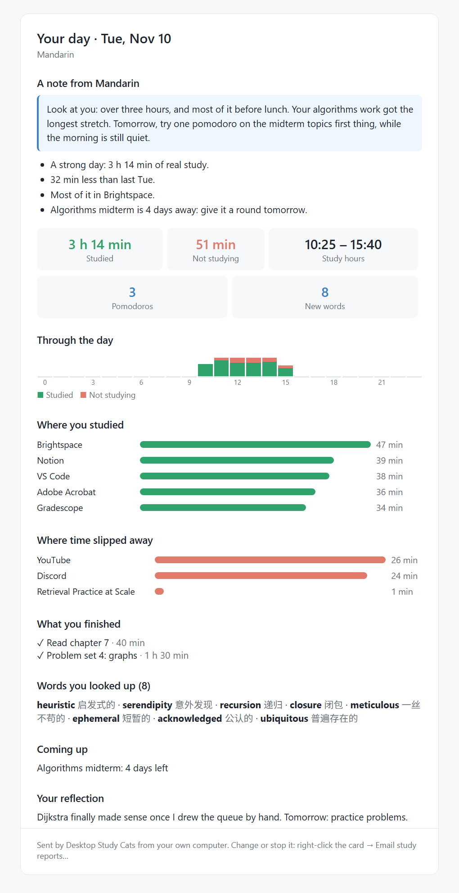
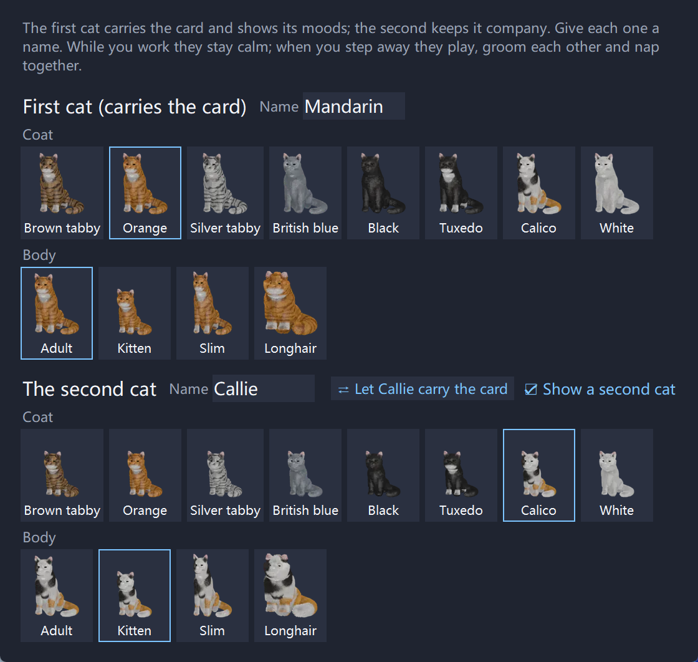
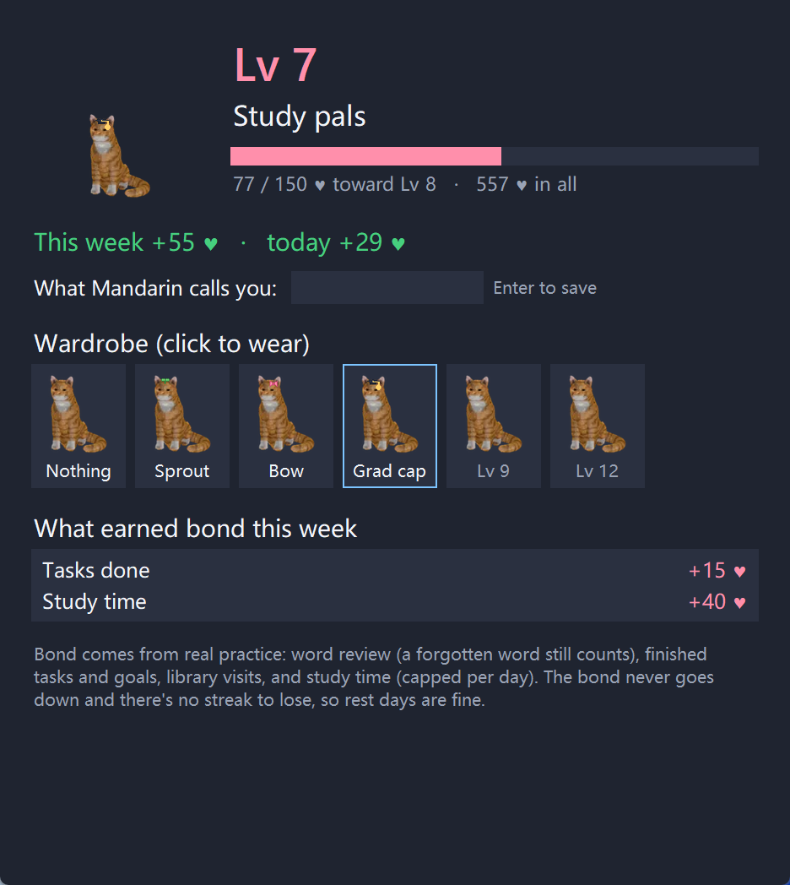
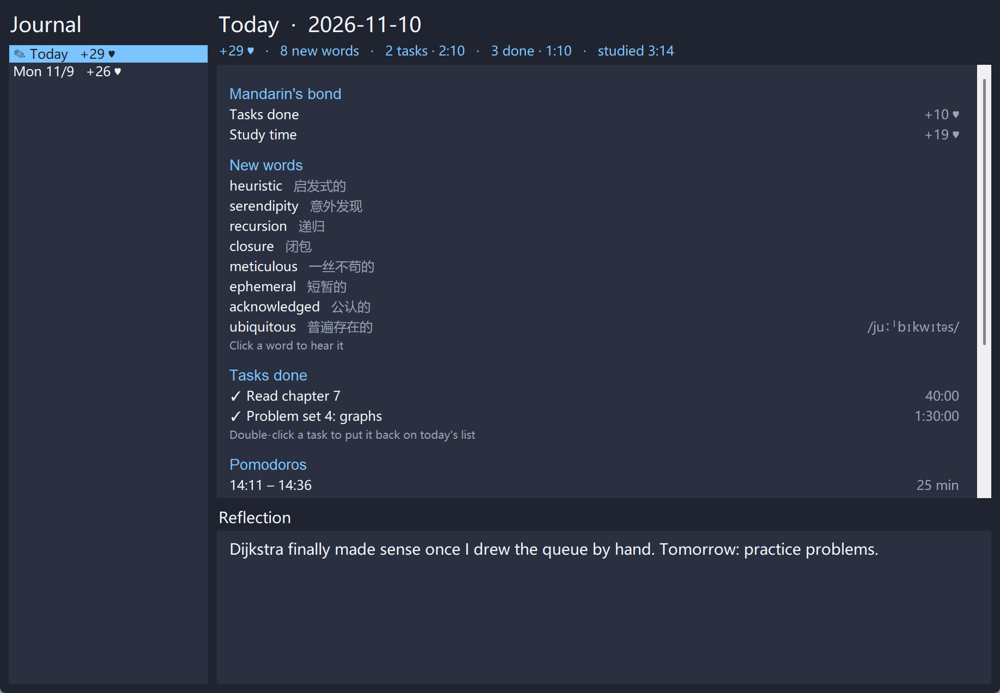

# Desktop Study Cats

**Two realistic cats live on your Windows desktop and keep you company while you study. Select a word in any app and tap Ctrl+Shift to look it up; review it later, focus in pomodoros that earn the cats their dinner, and get a study report by email every day.**


▶ **[Watch it in full quality (MP4)](docs/promo.mp4)** · <sub>Recorded for real on Windows 11 with the app's own windows and a real Edge window; the paper, notes and study data are examples made for the demo. See [How the demo was made](#how-the-demo-was-made).</sub>

| | |
| --- | --- |
|  |  |
| **A report in your inbox every day**: when you studied, where the time went, what you finished and looked up, and a note from your cat. | **Pick your cats**: 8 coats, 4 body types, a name each. Either one can carry the card. |
|  |  |
| **The bond grows with practice**, never shrinks, and unlocks things for your cat to wear. | **A journal page for every day**, written by your features and finished by you. |

**At a glance:** look words up in any app, in 12 languages · counts the time you actually study · a study report in your inbox every evening · pomodoros that earn the cats their dinner · a bond with your cats that grows as you practise.

## What it does

### The cats

- **They live their own lives.** They sit about, blink, groom, yawn, nap and wander along the bottom of
  the screen. While you work they stay calm and only drop by to touch noses; when you step away they chase
  each other, play and nap cuddled up in their bed.
- **They answer you.** Click either cat and it turns to you and meows. Stroke one (move the mouse back
  and forth over it): it closes its eyes with pleasure, hearts float up, and if you keep going it melts down
  and lies there. A sleeping or eating cat just carries on with hearts.
- **Toys and a home.** Right-click → **Toss in the yarn ball / bell ball**: they stalk it, pounce, bat it
  between them or race for the yarn; drag a toy to tease them and let go to throw it. A food bowl, a water
  bowl, a scratching post and a bed sit on the desktop floor (drag them anywhere, or put them away).
- **They get hungry, and you feed them by studying.** Every bowlful is earned with a finished pomodoro.
  With an empty bowl, a hungry cat sits by it and looks at you.
- **The first cat carries the card** as its speech bubble and shows its moods. Right-click → **Cats…**
  names them, picks coats and bodies, hands the card to the other cat, or turns the second one off.

### Looking words up

- **Works in every app.** Select text anywhere and tap **Ctrl+Shift**. Text you can't select (images,
  scanned PDFs, video frames) works too: snip it with **Win+Shift+S** and Windows' own OCR reads it.
- **Hear it right away**, in natural neural voices (Microsoft Edge TTS) with regional accents.
- **More than a translation**: IPA for English, pinyin, romaji and other romanizations, and dictionary
  senses by part of speech.
- **12 languages, either direction.** Select text in your own language and you get it in the one you're learning.
- **Stays out of your way.** A plain Ctrl+C never triggers it, your clipboard is restored afterwards, and
  you can pause it.

### Studying

- **Pomodoros without a ticking clock.** Right-click → **Start round 1 of today**: 25 minutes of focus,
  then a break (15 minutes after every fourth round). The card shows today's rounds as dots (●●● ◑), the
  current one filling up like a moon. The card hints at what's next instead of giving orders ("Tiger curls up
  beside you", "Tiger's tummy is rumbling…") and a hungry cat goes to sit by its bowl. 25+5, 45+10, 50+10 or 15+3 in Settings.
- **Word review** with flash cards on growing intervals (1 → 2 → 4 → 7 → 15 → 30 → 60 days). Search,
  delete and export to CSV (opens in Excel, imports into Anki).
- **Goals & to-dos.** Long-term goals with a deadline and countdown; tasks for any day with a stopwatch.
  Finishing one pops up a small celebration.
- **Study time, detected on its own.** The app notices which program or site is in front and whether
  you're at the keyboard: VS Code, PDFs, Brightspace, Google Docs and lectures count; YouTube, social apps
  and time away don't. Re-sort any program with one click. Kept only on your computer.
- **Study reports by email.** Each day when you shut down: when you started and stopped, real study time
  vs. time that slipped away, where, an hour-by-hour chart, what you finished and looked up, your
  reflection, coming deadlines, and a short note from your cat (written by Claude) that compares the day only
  with your own recent days. A weekly report on Mondays, a monthly one on the 1st. Sent from your own Gmail
  with an app password kept in Windows Credential Manager.
- **The cat's bond.** Word review, finished tasks and goals, library visits and study time earn ♥. Levels
  unlock a nickname and things to wear (sprout, bow, grad cap, star clip, crown). It never goes down and
  there's no streak to lose, so rest days are fine: rewards tied to practice, not loss-framed streaks, as
  the research on motivation suggests.
- **A journal** with one page per day: tasks and their times, new words (click to hear them), pomodoros,
  library time, and a reflection you write.
- **Study buddy (Claude).** A slightly fussy friend to chat with. It runs Claude Code with the login
  already on your computer (no API key) and reads none of your files. Off by default.
- **Library check-in**, with a log, a calendar heatmap and your streak, and **Claude usage on the card**
  (how much of your 5-hour limit is used). Both off by default.

Every feature can be switched off in **Settings → Features**.

## Quick start

Requirements: **Windows 10/11** and **Python 3.10+** ([python.org](https://www.python.org/downloads/)).
Tested with Python 3.12.

```bat
git clone https://github.com/jia-jing-zhang-dev/desktop-study-cats.git
cd desktop-study-cats
setup.bat
```

`setup.bat` creates a virtual environment, installs the dependencies and starts the app. The cats appear
at the bottom of your screen. After that, start it with `run.bat`, or turn on **Start with Windows** in Settings.

### Standalone app (no Python needed)

```bat
.venv\Scripts\python -m pip install pyinstaller
.venv\Scripts\python packaging\build.py
```

This creates `dist\DesktopStudyCats-windows.zip` with `DesktopStudyCats.exe` and a how-to. The packaged app
keeps its data in `%APPDATA%\Word Popper` (an old name, kept so data stays put). It isn't code-signed yet, so
Windows SmartScreen asks the first time (**More info → Run anyway**).

## How to use it

| You want to… | Do this |
| --- | --- |
| Look up a word, phrase or sentence | Select it, then tap **Ctrl+Shift** (press both, release) |
| Look up text you can't select | **Win+Shift+S** and snip just the word |
| Hear it again | Click the card, or the cat carrying it |
| Pet a cat | Move the mouse back and forth over it |
| Focus and earn the cats a meal | Right-click → **Start round … of today**, then click the card when the cat smells dinner |
| Toss in a toy | Right-click → **Toss in the yarn ball / bell ball** |
| Review your words | Right-click → **Review**. Space shows the answer, **1** = forgot, **2** = knew it |
| Browse, search, export | Right-click → **My words** |
| Plan goals and tasks | Right-click → **Goals & to-dos** |
| Get a study report by email | Right-click → **Email study reports…**, fill in your Gmail and an app password, **Send a test now** |
| Look back on a day | Right-click → **Journal…** |
| Change languages, voice, pomodoro length | Right-click → **Settings…** |
| Stop it for a while | Right-click → **Pause** |

Sentences are translated and read aloud, but only words and short phrases (up to 4 words) go into your word list.

## Languages

| Language | Voices | Pronunciation guide |
| --- | --- | --- |
| English | US, UK, Australia | IPA |
| Chinese (Simplified / Traditional) | Mainland, Taiwan, Hong Kong | Pinyin |
| Japanese | Japan | Romaji |
| Korean | Korea | Romanization |
| French | France, Canada | — |
| German | Germany | — |
| Spanish | Spain, Mexico | — |
| Italian | Italy | — |
| Portuguese | Brazil, Portugal | — |
| Russian | Russia | Transliteration |
| Vietnamese | Vietnam | — |

The interface is in English or Simplified Chinese. To add another language, add a block to
[`i18n.py`](i18n.py) and an entry to [`languages.py`](languages.py). For screenshot OCR in a language other
than English, Windows needs that language's OCR pack (**Settings → Time & language → Language & region**).

## Settings

| Setting | What it does |
| --- | --- |
| Interface language | English or Simplified Chinese |
| I'm learning / Translate into | The language you read in, and your own |
| Voice, speech speed | Regional accent and speed for the language you're learning |
| Text size | Card and window text |
| Look up a word by | *Ctrl+Shift tap* (default) or *Copying (Ctrl+C)* |
| Translate screenshots | Turn Win+Shift+S OCR on or off |
| Start with Windows | Adds or removes a shortcut in your Startup folder |
| Pomodoro | 25+5, 45+10, 50+10 or 15+3 minutes |
| Features | Turn each feature on or off |

Settings are saved in `settings.json` and your data in `vocab.db`, both next to the script. Set the
`WORD_POPPER_HOME` environment variable to keep them somewhere else.

## Privacy

No account, no server, no telemetry. To do its job, the app sends the text you look up to:

- **Google Translate** (public web endpoint) for translation, dictionary senses and romanization
- **Youdao Dictionary** for English ↔ Chinese phonetics and definitions
- **Microsoft Edge text-to-speech** for the voices

The optional study buddy and report notes go through your own Claude Code login, and reports go out
through your own Gmail. Study-time tracking stores only program and site names (never window titles)
on your computer. OCR runs locally.

## Troubleshooting

- **Ctrl+Shift also switches my keyboard layout.** Turn that off (**Settings → Time & language → Typing →
  Advanced keyboard settings → Input language hot keys**) or set *Look up a word by* to *Copying (Ctrl+C)*.
- **No sound.** Edge voices need an internet connection; offline, the app falls back to the Windows voice.
- **"Translation failed".** The free translation endpoint limits how often you can ask; wait a few minutes.
- **"No text selected".** Some apps don't support copying. Use Win+Shift+S instead.
- **Nothing happens in an app running as administrator.** Windows blocks keystrokes from a normal app to an
  elevated one. Run this app as administrator too, or use a screenshot.

## Project layout

```
word_popper.py      the card, hotkey, clipboard watching and lookup flow
lookup.py           translation (Google), dictionary (Youdao), OCR (Windows.Media.Ocr)
speech.py           Edge TTS with an mp3 cache; SAPI fallback
features/pet.py     the desktop cats: actions, petting, the two cats together
furniture.py        bowls, scratching post and bed; toys.py: the yarn and bell balls
cat_skins.py        the Cats window (names, coats, bodies)
features/pomodoro.py  pomodoros that earn the cats their meals
report.py           daily / weekly / monthly study reports by email
vocab.py            SQLite word list, review window, word-list window
library.py          library check-in, goals and to-dos, and their windows
journal.py          day-by-day journal built from each feature's sections
focus.py            study-time detection: foreground window + idle time, rules, the study-time window
buddy.py            study buddy: runs `claude -p`, the chat window
bond.py             the cat's bond: points, levels, accessories
features/           one module per feature; copy _template.py to add one
tools/cat_render/   Blender scripts that render the cats' frames
demo/               the script that records the demo above
```

## Adding a feature

Everything beyond word lookup is a feature in [`features/`](features): a small class that can add
right-click menu items, a window, a timer, and a section to each journal page. Copy
[`features/_template.py`](features/_template.py), add its strings in both languages to [`i18n.py`](i18n.py),
and list it in [`features/__init__.py`](features/__init__.py). It then shows up in the menu, in Settings →
Features, and in the journal. [`CLAUDE.md`](CLAUDE.md) has the details.

## How the demo was made

The promo is cut from two real recordings of the app, not mock-ups. [`demo/record_cats.py`](demo/record_cats.py)
films a cats reel and a study-day reel (`DEMO_REEL=study`: Spanish and Japanese lookups on
[`demo/notes.html`](demo/notes.html), the study-time window, the daily report, a level-up). It runs
the app with a throw-away data folder full of made-up study data, puts Windows' default wallpaper and the
usual desktop icons behind it ([`demo/desktop_look.py`](demo/desktop_look.py), taken from the system at
recording time), and opens a normal Edge window with a fresh profile on an example paper
([`demo/paper.html`](demo/paper.html), written for the demo). Every step is driven from inside the app, so
the real mouse and keyboard are never touched; the cursor you see is drawn. The word is selected by the
browser itself and the translation is real. Before and during filming it checks that nothing but the demo
is on screen and throws the recording away otherwise; the stills come from the same run.
[`demo/make_promo.py`](demo/make_promo.py) then cuts it like a product video: a hook, a title card, one numbered
section per feature with punch-in zooms on the detail that matters, and an end card.

```bat
.venv\Scripts\python -m pip install -r demo\requirements.txt
.venv\Scripts\python demo\record_cats.py
set DEMO_REEL=study && .venv\Scripts\python demo\record_cats.py
.venv\Scripts\python demo\make_promo.py
```

## Credits

The desktop cats are renders of **"An Animated Cat"** by **Evil_Katz**, CC-BY-4.0, from
[Sketchfab](https://sketchfab.com/3d-models/an-animated-cat-aec25699660043a29595f9572149d1e8), re-posed,
re-coloured and given fur for this app. See [`assets/cats/CREDITS.md`](assets/cats/CREDITS.md) and
[`tools/cat_render/`](tools/cat_render/).

## License

[MIT](LICENSE)
